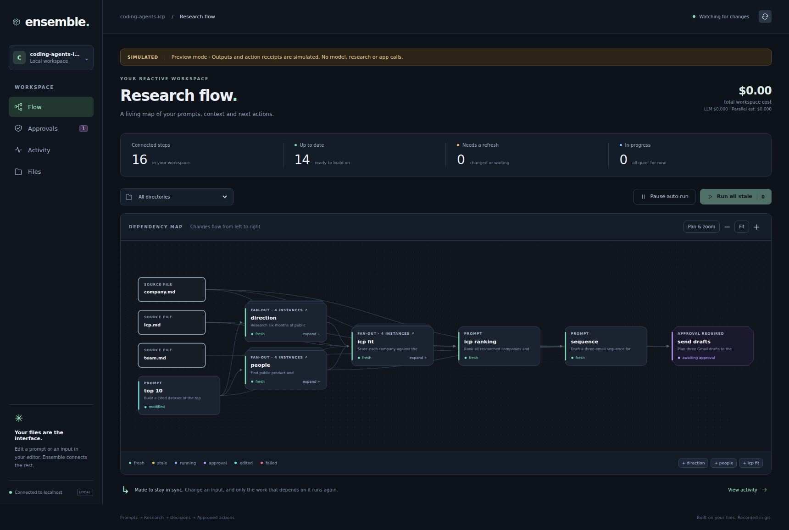
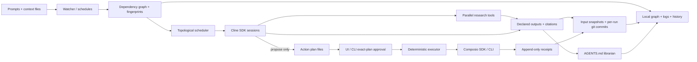

# Ensemble

Ensemble turns a directory into a reactive research-to-action workspace. Keep
prompts in `*.prompt.md` files, declare their inputs and outputs, and edit your
context in your normal editor. Ensemble reruns stale steps in dependency order,
fans research out across a list, keeps AGENTS.md current, and records each run in
git. Cline SDK sessions do the work, Parallel supplies cited research, and
Composio actions wait for approval of an exact, reviewable plan.



*Actual browser screenshot. Research and action receipts in this preview are explicitly simulated.*

[Five-slide deck PDF](deck/deck.pdf) · [Marp source](deck/deck.md) ·
[Two-minute demo script](docs/demo-script.md) · [Technical specification](SPEC.md)

## Install and run

Requires Linux or macOS (WSL works), Git, **Node ≥ 22.22.3**, and pnpm. The repo
declares pnpm 11.5.2. For real runs, provide Cline authentication, a Parallel API
key, and connected Gmail/Linear accounts through the selected Composio backend.
Application PDF export remains deferred. The five-slide deck is available as a
[PDF](deck/deck.pdf); regenerate it with `pnpm deck` using an installed Chrome or Chromium browser.

After cloning this repository:

```bash
pnpm install
pnpm build
export PATH="$PWD/bin:$PATH"

ensemble init ../ensemble-demo --example coding-agents-icp
cp .env.example ../ensemble-demo/.env
cd ../ensemble-demo
```

The absolute `bin/` entry remains on PATH after changing directories. Commands
find the nearest parent `ensemble.yaml`, so they also work in workspace subfolders.

Edit the new workspace's `.env` and `ensemble.yaml` before starting real work:

- Set `CLINE_API_KEY` and `PARALLEL_API_KEY` in `.env`. Existing `cline auth`
  login settings can be read through an isolated copy; live OAuth reuse and
  refresh remain unverified, so the API key is the reliable setup path.
- Set `vars.demo_recipient` to **your own connected Gmail address**. The supplied
  `you@example.com` is a placeholder and cannot create real demo drafts.
- Set `vars.linear_team_key` to a team in your own Linear workspace. Team and
  assignee identifiers are resolved during planning; fictional team contacts
  must never become actual recipients or arbitrary assignees.
- For the smaller smoke workspace, persist **`vars.row_limit: 3`** in the YAML.
  The full demo uses 10. A one-off `run --var row_limit=3` does not change the
  daemon's future defaults and can trigger a costly refresh after restarting.

Secrets belong in ignored `.env` or environment variables, never in YAML or
committed context. If Gmail and Linear are already connected under your active
backend, reuse those connections. Otherwise, explicitly link them:

```bash
ensemble connect gmail linear
ensemble doctor
ensemble graph --mermaid
ensemble dev
```

Open the printed `http://127.0.0.1:4567` URL. **`dev` immediately runs stale auto
prompts using real services.** Read the cost estimates below first. For graph
preflight, use `ensemble dev --paused` and resume from the UI when ready;
pausing prompt scheduling does not disable librarian summaries. Set
`agents_md.summaries: false` to keep indexing deterministic without model calls.

`doctor` makes a tiny real Cline call, inspects the workspace and connections,
and checks browser installation. `doctor --no-llm` skips the Cline smoke call.
`doctor --smoke-parallel` additionally requests one fast search, estimated at
$0.001. Installation alone does not prove Chromium can launch: browser process
permissions are a separate check.

For a cost-free preview, initialize a **separate** workspace and run
`ensemble dev --simulate`. This explicitly selects synthetic agent outputs and
simulated action receipts; it makes no model, Parallel, or Composio calls. Keep
that workspace separate from real research so simulated outputs cannot be
mistaken for live results. No credentials are required for preview mode.

## Composio account selection

`composio.backend: auto` selects the SDK only when `COMPOSIO_API_KEY` begins
with `ak_`; otherwise it uses the installed Composio CLI.

| Backend | Authentication | Connections |
| --- | --- | --- |
| `sdk` | A project `COMPOSIO_API_KEY=ak_…` and `composio.user_id` | Connections belonging to that SDK project/user |
| `cli` | The Composio CLI's own login | The CLI's consumer-project connections |

Consumer credentials such as `ck_` or `uak_` are **not** SDK project keys. CLI
connections do not automatically appear in an SDK project, or vice versa.
`ensemble doctor` prints the selected backend, and `ensemble connect` always
uses that same backend. Use the [Composio CLI instructions](https://docs.composio.dev/docs/cli)
to install/login when choosing CLI mode. Ensemble does not upgrade or overwrite
global Cline or Composio configuration.

## How it works



Inputs, prompt bodies, rendered item data, model/tool choices, and output paths
form content fingerprints. Unchanged fingerprints make reruns a no-op. Changes
propagate downstream, while independent ready steps can run concurrently.
`mode: manual` excludes a prompt from automatic runs. Failed upstream work blocks
its consumers. Hand-edited generated outputs are preserved as `modified`; the
UI lets you accept the edit or explicitly replace it with a forced rerun.

Every output has one producer. Paths stay inside the workspace, including
symlink checks. Agent file writes are guarded against undeclared outputs and
audited afterward; shell access is off by default and limited to guarded reads
when enabled. Input snapshots and successful output commits are serialized,
preserving unrelated staged files. Ensemble never pushes, moves, or deletes
user files as workspace cleanup.

## Prompt files

Save a prompt next to the output it owns:

```markdown
---
description: Research public API tooling for our ICP
inputs:
  - /context/company.md
  - /context/icp.md
outputs:
  - api-landscape.md
tools:
  parallel: [search, extract]
  composio: []
  shell: false
mode: manual
timeout: 20m
budget_usd: 1
---
Find relevant public API tools. Write api-landscape.md with evidence, citations,
and explicit unknowns. Call ensemble_complete after writing the declared output.
```

Paths resolve relative to the prompt file's directory; `/context/icp.md` starts
at the **workspace** root. Inputs accept globs, directories, and optional `?`
suffixes. Outputs are concrete paths, never globs. Declare the
`<output>.sources.json` sidecar when using `parallel_dataset`.

| Frontmatter | Meaning |
| --- | --- |
| `outputs` | Required nonempty output list for prompts |
| `inputs` | Files/globs to read and fingerprint; defaults to `[]` |
| `description`, `id` | Human-readable purpose and optional stable identifier |
| `mode` | `auto` (default) or `manual` |
| `foreach` | CSV, JSON list, or glob source; object form supports `from`, `as`, `key` |
| `vars` | Per-prompt overrides of workspace variables |
| `tools.parallel` | Tool names such as `search`, `extract`, `dataset`, `research`, `enrich`, `findall`; `[]` disables web tools |
| `tools.composio` | Allowed tool slugs or toolkit names; prompts receive read-only tools |
| `tools.shell` | Guarded shell reads; default `false` |
| `model` | Override the workspace model; `provider:model` also selects a provider |
| `timeout`, `budget_usd` | Per-run abort guards, not a workspace billing limit |
| `parallel.max_processor` | Research processor cap, additionally capped by workspace config |
| `incremental` | Include previous-output/input-change context; default `true` |
| `schedule` | Standard five-field cron in the machine's local timezone |
| `export` | `[pdf]` is reserved metadata; PDF rendering is deferred |
| `derived_from` | Lineage written by `ensemble clone` |

Templating uses strict Handlebars: unknown variables fail. Workspace and prompt
variables appear as both `vars.name` and `name`; fan-out items appear under
`foreach.as`, with `_key` and `_index`. Helpers are `slugify`, `today`, `json`,
`lower`, and `upper`. `prompt.path`, `prompt.dir`, and `workspace.root` are also
available. Unknown frontmatter keys generate warnings.

`context/` holds source context, `exports/` is reserved for future exports, and
`.ensemble/` holds ignored runtime state. Other folder names are your choice. Initialization writes
AGENTS.md indexes, missing-only `CLAUDE.md` shims, and an authoring skill in both
`.agents/skills/ensemble/` and `.claude/skills/ensemble/`. User text outside
managed AGENTS.md blocks is preserved; index writes do not trigger prompt runs.

## Fan-out, fan-in, and iteration

```yaml
foreach:
  from: ../../top-10.csv
  as: company
  key: "{{slugify company.company_name}}"
inputs:
  - ../{{company._key}}/people.md
  - ../{{company._key}}/direction.md
  - /context/icp.md
outputs:
  - ../{{company._key}}/icp-fit.md
tools:
  parallel: []
```

Each row becomes an independent node. Adding a row runs the new company's chain;
existing instances stay fresh. Fan-in prompts declare a glob such as
`companies/*/icp-fit.md` and wait for every producer before running. Expansions
above `scheduler.fanout_confirm_over` wait for explicit approval in the UI or
`ensemble approve-fanout <prompt>`.

Use `ensemble clone <prompt> [new-path]` to create a variant with `derived_from`
and nonconflicting output paths. `ensemble new <file.prompt.md>` scaffolds a
manual prompt. `--from-description` fills the description/body; it does not run
an authoring LLM. For scheduled read-only work, a calendar prompt can declare
`schedule: "0 9 * * 1-5"`, `tools.parallel: []`, and
`tools.composio: [GOOGLECALENDAR_EVENTS_LIST]` to refresh a declared local output.

```bash
ensemble status --json
ensemble run coding-agents/icp-ranking.prompt.md --dry-run
ensemble explain coding-agents/icp-ranking.md
ensemble history coding-agents/icp-ranking.md
ensemble logs coding-agents/icp-ranking
ensemble index --no-llm
```

## Action approval and safety

An `*.action.md` declares inputs and `tools.composio`, with `plan: auto|manual`.
It has implicit `.plan.json`, `.plan.md`, and `.receipt.json` paths. Planning may
call allowlisted read-only tools to resolve identifiers. Write tools are
**proposals only**; the planner cannot create drafts, send messages, or create
tickets. The executor runs no LLM.

Review the complete JSON or the UI's email/ticket cards, edit as needed, and then
approve the exact plan. UI edits and approvals carry the reviewed SHA-256; a
changed plan or stale inputs invalidate approval. Execution resolves references
to earlier results, validates tool arguments, runs steps in order, and stops at
failure. Receipts record exact resolved arguments and results. Re-approval skips
successful matching steps. Concurrent approval clicks are serialized.

```bash
ensemble plan coding-agents/outreach/send-drafts.action.md
ensemble approve coding-agents/outreach/send-drafts.action.md --dry-run
# After reviewing and explicitly authorizing real draft/ticket creation:
ensemble approve coding-agents/outreach/send-drafts.action.md
```

Dry-run approval is labeled **SIMULATED** and never authorizes a later real run.
Dry-run receipts do not suppress real execution. If a request has an uncertain
transport outcome, inspect Gmail/Linear before retrying; `approve --force` is an
explicit override that can create duplicates. Do not force merely to clear an
error. The example allows **three Gmail drafts to your own address and one
Linear issue in your own workspace**, never email sending. Recipient safety is
checked across the plan before the first write, including CC/BCC restrictions.

## Example and expected costs

The complete [coding-agent ICP workspace](examples/coding-agents-icp/) ships
context and prompts, without committed research results or action receipts:

`top-10.csv → people + direction per company → ICP fit → ranking → email sequence → approved drafts + Linear issue`

Changing `context/icp.md` reruns only the fit reports and downstream synthesis;
people and direction research remain fresh. Public LinkedIn information is
limited to accessible web sources. Missing identities, funding, headcount, and
logged-in or paywalled content must remain unknown rather than invented.

These are planning estimates from the included
[Parallel research notes](docs/research/research-parallel.md), **not measured
live costs** or a current pricing guarantee:

| Initial workspace | Prompt/planning sessions | Baseline Parallel Tasks |
| --- | --- | --- |
| 3 companies | 13, plus librarian summaries | ~$0.055: one core dataset ($0.025) + three base reports ($0.01 each) |
| 10 companies (default) | 34, plus librarian summaries | ~$0.125: one core dataset + ten base reports |

Add roughly $0.001 per fast search and $0.001 per extracted URL; the number of
calls is agent-dependent, and more expensive search modes cost more. The example
caps dataset research at `core` and direction reports at `base`. LLM charges vary
with the chosen model, tokens, iteration count, retries, and summaries. As an
illustration only, an average $0.10–$0.50 per session would mean $1.30–$6.50 for
13 sessions or $3.40–$17 for 34, before librarian and research charges.

The default per-run budget is $3; it is **not** a total-workspace cap or a strict
provider billing guarantee. Review model prices and available credits before a
live pre-run. Identical Parallel requests use a persistent cache; unchanged
workspace runs are a no-op. Editing the ICP can still incur new synthesis and
librarian charges even when no new web research is needed.

## What's real vs simulated

| Capability | Implementation and verification |
| --- | --- |
| Dependency graph, fan-out, watcher, cron, git, librarian, approvals | Implemented and tested with real local files/git. Native CSV, watcher, five-field cron, and SVG graph implementations are real local code. |
| Cline agent sessions | Real `ClineCore` with guarded tools, tested against a mock OpenAI-compatible server. Live API-key doctor and guarded file-write/completion sessions passed; stored OAuth failed and uses the API-key fallback. |
| Parallel research | Real pinned SDK adapters, polling, cache, processor caps, citations and sidecars; tested with injected SDK/fetch responses. A live fast-search smoke passed. The full dataset/research pipeline has not been pre-run. |
| Composio actions | Real SDK/CLI adapters and deterministic executor, tested with recording/mock backends. A user-approved live Cline plan created three own-address Gmail drafts and one Linear issue; provider readback and idempotent replay passed. |
| `dev --simulate` | Explicit synthetic agent/research outputs and simulated receipts. Every preview is labeled; this is never the production default. |
| UI | Actual React components, rendered-content/security tests, static-serving/API tests, and a native SVG graph. Eight Chromium scenarios passed, including editor-driven cascades, fan-out, drawers/history, simulated approvals, file links, and activity. The screenshot uses synthetic research. |
| PDF and deck | Application PDF export is deferred. The five-slide Marp deck PDF is rendered and visually checked. |

Core pins are `@cline/sdk@0.0.95`, `parallel-web@1.3.5`, and
`@composio/core@0.25.0`. TypeScript uses ESM with `moduleResolution: Bundler`;
Cline runs with `backendMode: local`. The SDK's rule injection required explicit
AGENTS-chain injection, and approval/disabled-tool policies must be set together
at the top level. See [spike outcomes](docs/spikes.md),
[milestone verification](docs/progress.md), and
[restricted-environment details](docs/environment-offline.md).

Initial sandbox restrictions were lifted for final testing. Normal pnpm installation,
production build, TypeScript, 123 tests, browser interaction and live integration
smokes now pass. See [final verification](docs/live-verification.md). The full
10-company live research workspace remains a separate pre-run before recording.

Before recording, run the live Cline/Parallel checks, open the daemon in a real
browser and explicitly approve the demo drafts/ticket in your
own connected accounts. The [demo script](docs/demo-script.md) includes the
preflight and disclosure. Publishing the repository and recording/uploading the
video are owner actions; no published submission URLs are claimed here.

## Development

```bash
pnpm test
pnpm typecheck
pnpm build
pnpm exec playwright install chromium
pnpm smoke:browser
```

Tests use FakeRunner, a local mock LLM, and injected integration backends; they
do not require credentials or spend provider credits. The optional
`scripts/bootstrap-offline.cjs` is a restricted-environment diagnostic helper,
not an alternative fresh-clone installation guide.

MIT licensed. [License](LICENSE).
