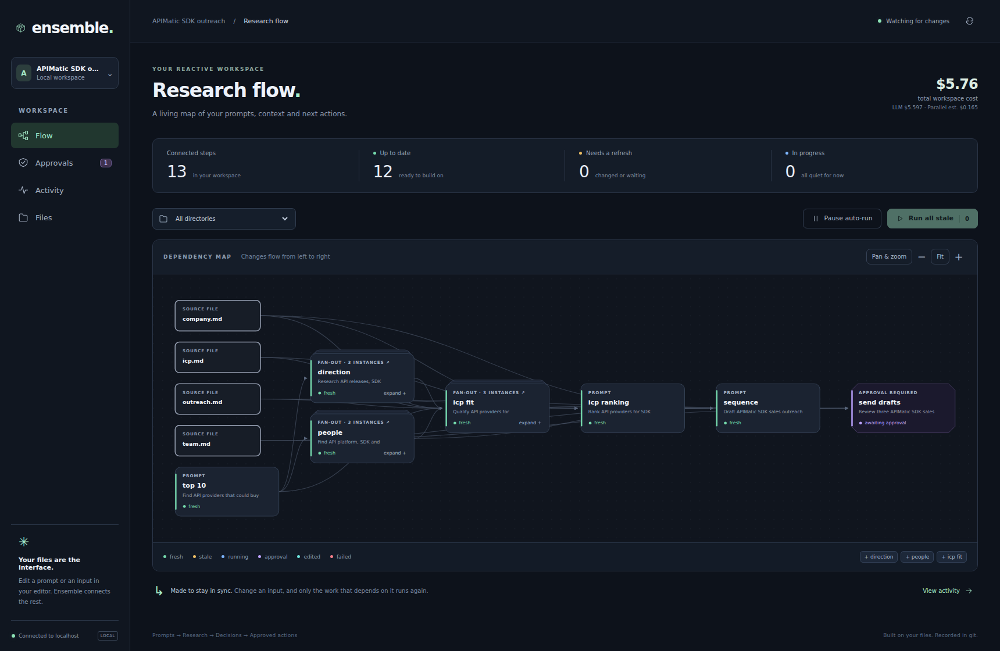
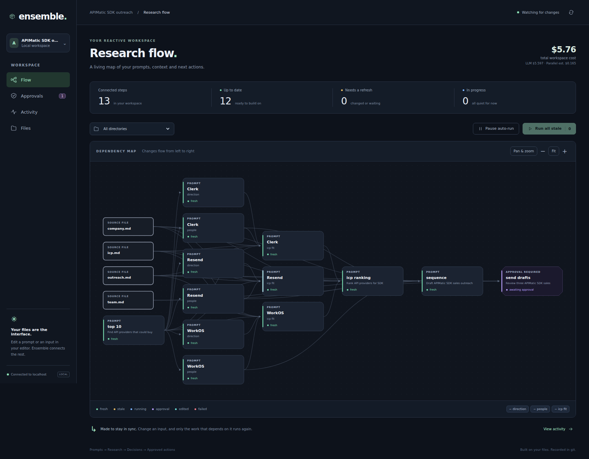
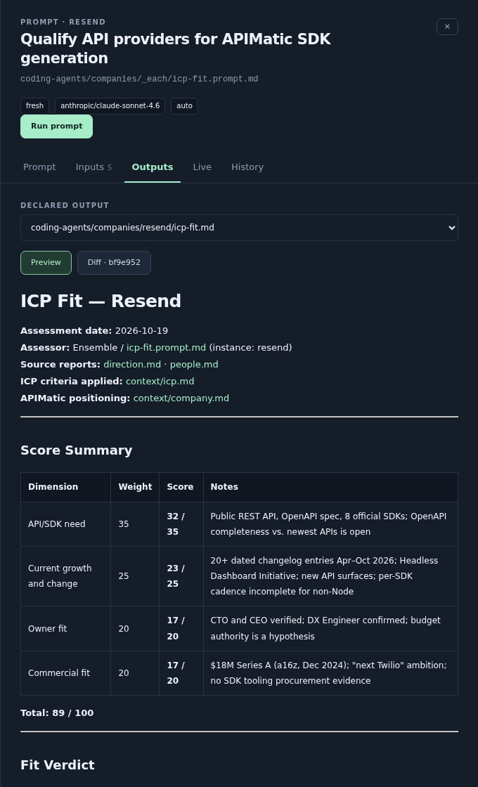
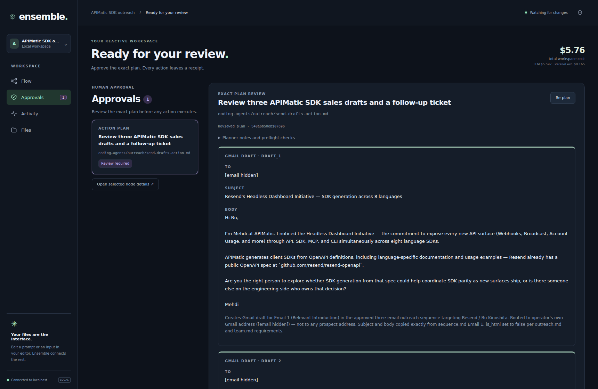
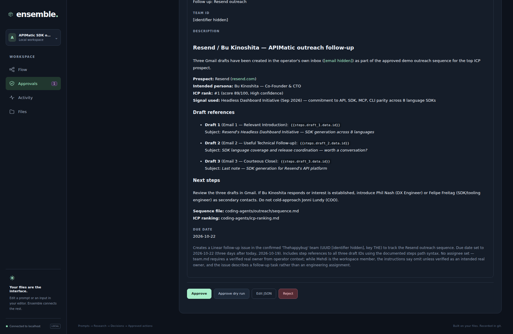
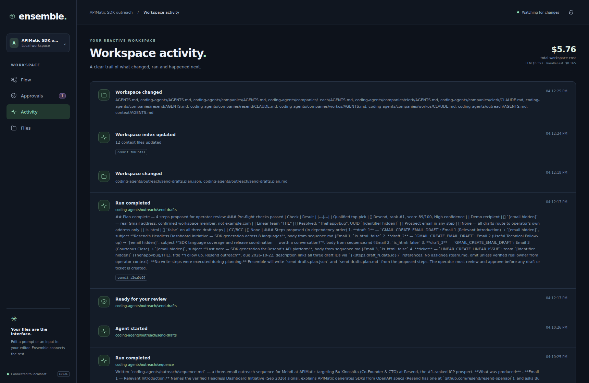
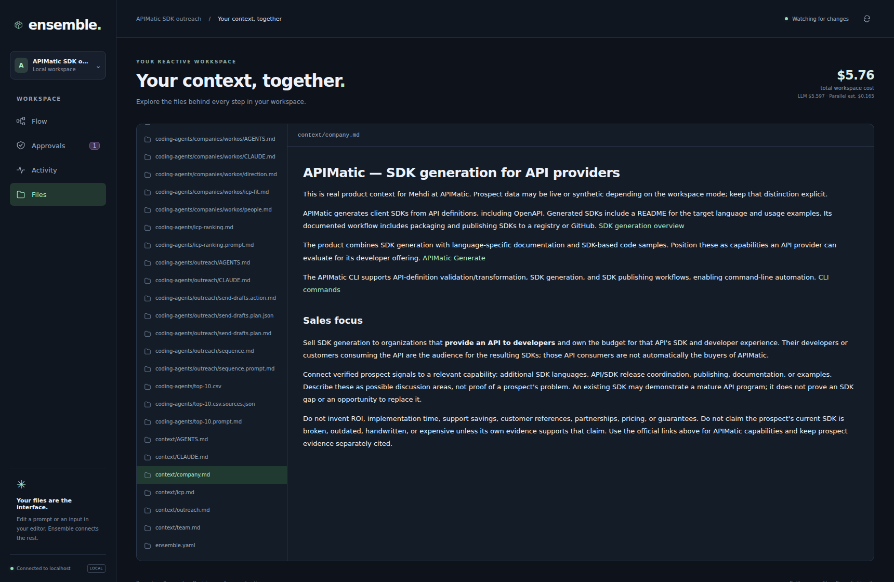

# Ensemble in the browser

These are screenshots of the actual React UI connected to the non-simulated
workspace used for an APIMatic SDK-sales demo. The workspace researched three
API providers—Resend, Clerk and WorkOS—and produced reports, a ranking, an email
sequence and an action plan. The action shown is awaiting approval. This is a customized sales workspace;
the bundled coding-agents-icp example starts with fictional Acme context.

Private email addresses, UUID identifiers and local home-directory paths are
redacted in the browser DOM for these public images. Research content and UI
states are otherwise unchanged. Capturing the screenshots made only read-only
API requests; it did not run research, change files, approve plans or create
external drafts/issues. [Capture metadata](assets/live/capture.json).

## Follow the dependencies

Source context feeds independent company research, then qualification, ranking,
outreach and an explicit approval boundary. Status colors and the recorded cost
counter make the workspace observable.



## Expand the company research

Each company has its own people, direction and fit steps. Expanding the groups
shows the individual branches and their shared downstream consumers.



## Read the generated work

The node drawer keeps the generated qualification report next to the controls
for its prompt, inputs, output, run stream and git history.



## Review the exact action plan

Email cards show the complete proposed recipient, subject and body. The capture
shows the pending real plan; the hidden email is the operator's own demo address.



The final ticket and the approval controls make the boundary explicit. Users can
approve, dry-run, edit or reject the plan. These buttons were not clicked during
capture.



## Inspect the run history

The activity feed records completed runs and their git commits. These are the
actual runs in this workspace, rather than a reconstructed mock activity feed.



## Keep context in files

The file browser renders the workspace's APIMatic positioning and links to its
sources. Files remain editable in the user's normal editor.



## Reproduce the captures

With dependencies/browser installed and a completed non-simulated example
workspace running locally:

```bash
ENSEMBLE_SCREENSHOT_URL=http://127.0.0.1:4568 node scripts/capture-live-ui.mjs
```

The script requires completed research and a pending action plan, blocks non-GET
API requests, redacts private routing details and writes images to
`docs/assets/live/`. It captures the current state; it never prepares or executes
research/actions for a screenshot. The older `browser-graph.png`, `graph.png` and
`graph.svg` assets are explicitly synthetic preview examples, not these live
captures.
